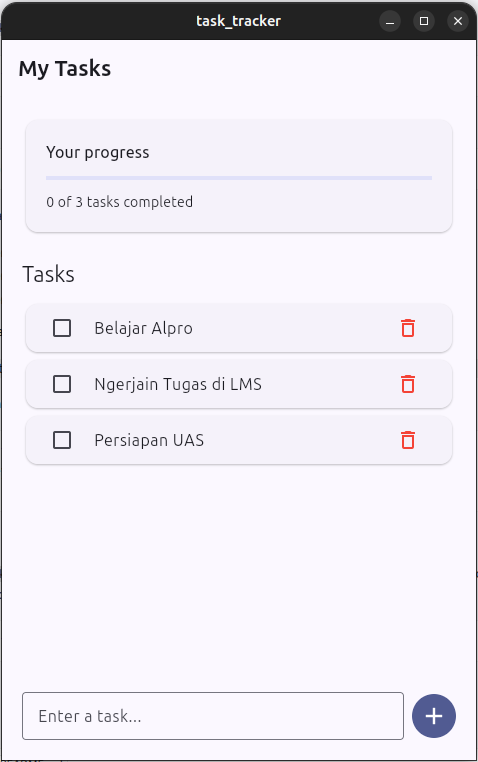

# Task Tracker

## Nama & NIM : Damar Syahada Kusuma (103022500007)

### Dokumentasi Demo

### Langkah Menjalankan Aplikasi

1. Pastikan SDK Flutter dan SDK Android sudah terpasang.
2. Jalankan `flutter pub get` untuk memasang dependensi.
3. Jalankan aplikasi dengan perintah `flutter run -d linux` (khusus pengguna linux untuk development).

### Deklarasi Penggunaan AI

- Apakah menggunakan AI? Ya
- Tool AI yang digunakan: Deepseek
- Estimasi persentase kontribusi AI: 30 % (Maksimal 40%)
- Bagian kode/fitur yang dibantu AI:
  Membantu merekonstruksi arsitektur code agar lebih rapih dan mudah di maintenance, dan membantu memahami cara kerja dari flutter.
- Pernyataan:
  "Saya menyatakan bahwa saya memahami alur dan fungsi dari seluruh kode yang ada dalam repositori ini"
